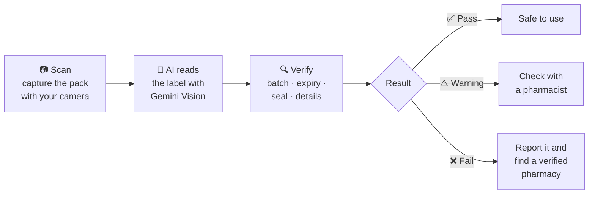

<div align="center">

# MediScan

### Verify medicine instantly.

Point your phone camera at a medicine pack and MediScan's AI reads the label, checks the batch, expiry and seal, and tells you in seconds whether it looks genuine.

[](https://mediscan-47870.web.app/)


</div>

---

## About

**The problem:** counterfeit and substandard medicines are a serious public-health risk in India and worldwide, and expired stock still reaches shelves. A buyer standing at a pharmacy counter has no quick way to tell whether the strip in their hand is genuine.

**The solution:** MediScan turns any phone into a verification tool. It captures the packaging, uses Google Gemini's vision model to read every important detail on the label, checks it for red flags, and gives a clear **pass / warning / fail** result, along with an AI assistant to answer follow-up questions.

---

## How It Works



**Three steps to safer medicine:** scan the pack, let the AI analyse it, and get a clear verdict.

---

## Key Features

| Feature | Description |
|---|---|
| 📷 **In-Browser Camera Scan** | Capture the pack directly from the browser; no app install needed. |
| 🧠 **AI Label Reading** | Gemini Vision extracts all key details from the packaging image. |
| ✅ **Clear Verdict** | Every check is marked pass, warning or fail, with an overall result. |
| 📅 **Expiry Validation** | Reads and validates the printed expiry date automatically. |
| 🧾 **OCR Slip** | Scan a pharmacy slip or prescription and read it as text. |
| 💬 **Doc AI Assistant** | Ask questions about a medicine by text or voice. |
| 📍 **Verified Pharmacy Finder** | Finds the nearest verified pharmacy through Google Maps. |
| 🚩 **One-Tap Reporting** | Report a suspected counterfeit to drug authorities. |
| 🌐 **Multilingual** | Language selector and audio support for wider accessibility. |

---

## What MediScan Checks

| Field | What the AI looks for |
|---|---|
| **Brand name & strength** | The product name and dosage as printed |
| **Batch / lot number** | Present, legible and correctly formatted |
| **Expiry date** | Present, readable and not in the past |
| **Manufacturer** | The manufacturer name on the pack |
| **MRP** | The printed maximum retail price, with currency |
| **Active ingredients** | Ingredients and their amounts |
| **Seal condition** | Intact, absent or tampered |

---

## Tech Stack

| Layer | Technology |
|---|---|
| **Framework** | React 18, TypeScript, Vite |
| **Styling** | Tailwind CSS, shadcn/ui (Radix UI), Lucide icons |
| **Routing & data** | React Router, TanStack Query |
| **Forms & validation** | React Hook Form, Zod |
| **AI** | Google Gemini API (vision and chat) |
| **Browser APIs** | MediaDevices (camera), Web Speech |
| **Charts** | Recharts |
| **Hosting** | Firebase Hosting |

---

## Getting Started

**Prerequisites:** [Node.js](https://nodejs.org) 18+ and a [Google Gemini API key](https://aistudio.google.com/app/apikey).

```bash
# 1. Clone the repository
git clone https://github.com/dhruvagrawal514-boop/MediScan.git
cd MediScan

# 2. Install dependencies
npm install

# 3. Start the dev server
npm run dev
```

Then open `http://localhost:8080` (or the URL Vite prints).

**Build and deploy**

```bash
npm run build
firebase deploy
```

> Camera access requires `localhost` or HTTPS.

---

## Roadmap

- [x] Camera scan and AI label extraction
- [x] Pass / warning / fail verification
- [x] Doc AI assistant and pharmacy finder
- [ ] Cross-check batch numbers against official drug databases
- [ ] QR / barcode verification for packs that carry them
- [ ] Scan history for signed-in users
- [ ] Android app

---

## Author

**Dhruv Agrawal**

[](https://www.linkedin.com/in/dhruv-agrawal-0b8a46204)
[](https://github.com/dhruvagrawal514-boop)
[](mailto:dhruvagrawal514@gmail.com)

<div align="center">

If you like this project, consider giving it a ⭐

</div>
